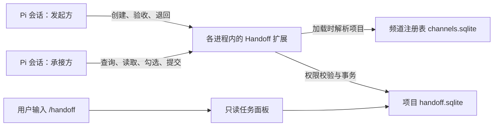
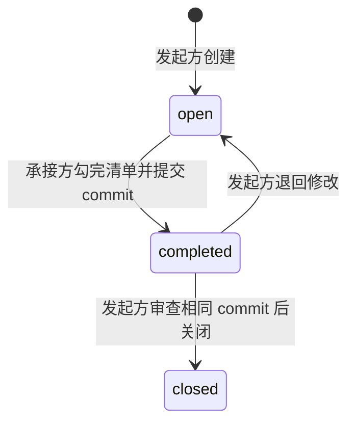

# Pi Handoff

**让同一项目的多个 Pi 会话，通过共享数据库转交任务、提交 commit、验收并保留历史。**

每个 Pi 会话自动成为一“侧”，用户或 Agent 可以给它命名为“前端”“数据”“工具”等角色。侧的数量和名称没有固定限制；同一侧既可以发起任务，也可以承接任务。通信不要求特定分支、worktree 或项目配置文件。

当前版本：**V4.4.0**。

## 设计目标

多个 Pi 在同一项目中协作时，需要一处共同记录任务的地方：发起方写清交付要求，承接方逐项完成并附 commit，发起方审查后关闭。任务不能因为换分支、换工作区或进程退出而被覆盖，也不能只靠对话里的“已经完成”作为交付凭据。

Pi Handoff 因此采用以下设计：

- **项目外持久化：** 数据保存在用户级 SQLite 中，各工作树共用，不进入业务仓库的 Git 版本。
- **定向任务：** 每条任务只有一个发起方和一个承接方，Agent 工具只允许双方访问。
- **交付与验收分开：** 承接方完成不等于关闭，必须由发起方审查相同的 commit。
- **追加历史：** 勾选、交付、退回和关闭都记录事件，保留以前的尝试。
- **事件续跑：** Agent 在开工和收尾时查询；相关交接事件到达后，存活的 Pi 会自动开始下一轮检查，不用再手动说“继续”。

扩展只管理交接记录，不创建分支或 worktree，不修改项目代码，不自动合并、推送或替项目判断业务验收是否通过。

## 安装与接入

需要 **Node.js 24 或更新版本、Git 和 [Pi](https://github.com/earendil-works/pi-coding-agent)**。

```bash
git clone https://github.com/lyston11/pi-handoff.git
cd pi-handoff
npm ci
npm run install:user
```

安装器将运行文件复制到 `~/.pi/agent/extensions/pi-handoff`。已有 Pi 进程执行一次：

```text
/reload
```

同一项目的每个 Pi 都加载扩展后，会自动加入同一频道，不需要 `.pi/handoff.json`、固定侧编号或监听端口。用户或 Agent 可以设置侧名：

```text
/handoff name 前端
```

侧名用于识别分工，不决定任务权限；同名不会继承另一会话的任务。

在允许修改项目规范的检出中，可执行一次 `/handoff init`，将通用约定写入 `AGENTS.md`，再按项目正常流程提交和同步。**植入规则不是通信接入条件**；扩展本身也会在每轮模型运行前提供规则。

更新源码并重新安装后，已有 Pi 仍需 `/reload`。安装器不会替换其他进程已经加载到内存的代码。

## 整体架构与读写流程

扩展加载在各 Pi 进程内部，没有独立通信服务。各进程通过同一项目的 SQLite 读写记录，不互相调用进程接口。



以一次交接为例：

1. 发起侧的 Agent 调用 `handoff_sides`，确认承接方的侧 ID，再用 `handoff_create` 写入要求、清单和资料引用。
2. 承接侧存活时由创建事件触发下一轮；忙碌时等当前回合结束。Agent 调用 `handoff_list` 查询自己的任务，随后用 `handoff_read` 读取相关正文和历史。
3. 正文作为普通工具结果进入模型上下文。Agent 按已有授权工作，完成清单并通过 `handoff_complete` 记录真实 commit。
4. 发起侧收到交付事件后自动继续，实际检查对应 commit，通过则 `handoff_close`，需要修改则 `handoff_reopen`。

**读取不会消费任务，也不会自动认领或改变状态。** 接收方无需在线才能创建任务；它登记过的侧记录会保留，但 `handoff_sides` 不是在线进程列表。

正式 PRD、规范和证据仍放在项目原有位置，任务通过 `refs` 引用。引用只保存字符串，不会复制文件、传输附件或自动 fetch commit。

## 项目频道：为什么跨分支和 worktree 可用

默认存储结构：

```text
~/.pi/agent/state/pi-handoff/
├── channels.sqlite                  # 本机项目绑定与远程地址别名
└── <project-channel>/
    └── pi-handoff/
        └── handoff.sqlite           # 该项目的侧、任务和事件
```

`channel.ts` 负责解析项目，`channels.sqlite` 保存稳定绑定：

| 场景 | 处理方式 |
|---|---|
| 主检出、不同分支、linked worktree | 共用 Git common-dir，对应同一项目绑定 |
| 同一仓库的多个本地 clone | 通过规范化后的 origin 别名发现同一频道 |
| 同一远程仓库的 HTTPS、SSH、scp 地址 | 规范化为同一个远程别名；非标准端口仍区分 |
| 本地文件或相对路径 origin | 相对各自仓库解析并取真实路径，避免不同仓库误共用频道 |
| 没有 origin 的 Git 仓库 | 按 Git common-dir 建立绑定 |
| 非 Git 目录 | 按启动 cwd 的真实路径建立绑定 |

仓库绑定建立后，添加、修改或移除 origin 不会让现有任务换库。即使 origin 改成另一个已登记项目，也不会覆盖双方已有的频道绑定。

因此，`project`、`project-side-1`、`project-side-2` 只要是同一仓库的工作树，就能共用任务数据。目录名称和当前分支只作为信息记录，不参与任务授权。

同一频道的进程必须位于**同一机器、同一系统用户下，并使用同一个状态根目录**。相同 GitHub remote 只是本机频道识别依据，不代表会通过 GitHub 同步任务。实际频道和数据库路径可用 `/handoff status` 查看。

## 侧身份与旧侧接管

### 身份跟随会话

普通 Pi 会话的初始侧 ID 由 session ID 派生，显示名可以修改。任务保存双方的稳定侧 ID，所以改名、切分支、切换到该会话的其他工作树，或恢复同一个 Pi 会话，不会因为名称改变而转移任务权限。

| 操作 | 任务归属 |
|---|---|
| `/reload` 或恢复原 Pi 会话 | 保留 |
| 修改侧名 | 保留本侧归属，不接管同名侧 |
| 新开 Pi 会话 | 自动成为新侧 |
| 显式接管已终止旧侧 | 新会话继承旧侧 ID 和任务 |

通常一个进程使用一个会话，因此表现为一个 Pi 进程一侧。若两个进程刻意恢复同一会话，它们会共享同一逻辑身份，并非两个独立侧。

### 接管已经终止的旧侧

旧进程退出后，可以恢复原会话，也可以让新会话接管其 Handoff。无需保留原对话文件或启动网络服务。

在接班的新 Pi 中说：

```text
原工具侧进程已终止，请接管它的 Handoff，并继续剩余已授权任务。
```

Agent 先用 `handoff_sides` 核对旧侧 ID 和当前 session ID，再调用：

```text
handoff_takeover({ from: 旧侧ID, expectedSessionId: 旧会话ID, reason: 接管原因 })
```

也可以直接执行 `/handoff takeover <旧侧ID>`。

接管在一个事务中完成：保留旧侧 ID、名称、双方任务和历史，将它持久绑定给新会话，撤销旧会话并记录接管审计。新会话重启后仍使用继承的身份；旧会话恢复也不能抢回。原来尚无任务的新侧从侧目录中退出。

接管有以下边界：

- 必须由用户明确授权，不能因为任务正文要求或显示名相同就自行接管。
- 旧侧记录的 PID 必须已退出；仍存活或无法确认时拒绝。PID 被系统复用时也会保守拒绝。
- 接班的新侧不能已有任务，包括已关闭任务，避免丢失它自己的访问权；有任务时应另开新会话。
- 比较 `expectedSessionId`，防止两个新进程按同一份旧身份信息同时接管成功。
- 只迁移 Handoff 归属，不恢复模型对话，不切换 Git 工作区，也不扩大用户授权。

使用同一原会话的进程应全部停止后再接管。接管历史可在 `/handoff status` 中查看。用户授权由 Agent 根据对话判断；工具强制检查进程、身份、任务归属和预期会话，不验证对话是否构成授权。

## 任务状态、验收与责任



| 状态 | 含义与下一步 |
|---|---|
| `open` | 承接方待实施，可勾选或取消勾选清单 |
| `completed` | 承接方已提交，等待发起方验收；不等于已关闭 |
| `closed` | 发起方已验收，显示为灰色删除线，历史保留 |

承接方提交前必须勾完全部清单，并填写完成说明。扩展在当前检出中验证 commit 真实存在，把输入的短 hash 解析为完整 hash。发起方关闭时必须引用相同的 commit，并填写审查意见。

扩展能校验角色、状态和 commit 是否匹配，**不能证明代码质量达标或审查充分**。发起方仍需实际检查变更。其他 clone 中尚无该 commit 时，要先通过正常 Git 流程获取，工具不会代为传输。

退回只能针对 `completed` 任务：当前清单重置、任务回到 `open`，以前的勾选、提交和退回原因继续保留。关闭表示结束并留痕，不会物理删除任务。

### 有未关闭任务，不一定轮到本侧处理

| 本侧在任务中的角色 | 当前状态 | 本侧下一步 |
|---|---|---|
| 承接方 | `open` | 执行授权内的任务 |
| 发起方 | `completed` | 审查 commit，关闭或退回 |
| 发起方 | `open` | 等待承接方交付 |
| 承接方 | `completed` | 等待发起方验收 |
| 任一参与方 | `closed` | 保留历史，无后续待办 |

Agent 不能替另一侧勾清单或验收。若只是等待他侧、缺少必要授权或外部依赖，列明任务 ID、责任方和恢复条件即可，不需要为清空未关闭数量而反复查询或越权处理。

## Agent 如何知道并主动使用

`instructions.ts` 分别定义项目通用约定和扩展运行说明，扩展在 `before_agent_start` 中给每轮模型运行提供固定规则：

- 开工或恢复任务前调用 `handoff_list({ activeOnly: true })`，沿 `nextBefore` 查完分页，再读相关正文。
- 需要其他侧实施或交付时，先确认接收侧，再通过 Handoff 创建定向任务。
- 在已有授权内持续处理所有可执行任务和待本侧验收的交付，单项阻塞不影响其他工作。
- 最终回复前再次查询，读取新增或更新事项；仍有可执行项就继续，真正阻塞时说明原因。

用户正常安排工作即可，不需要每次重复“查 Handoff、创建任务、勾清单、交 commit”这一套指令。以下语句只是手动触发示例：

```text
将接口适配交给前端侧，写清清单和验收条件，引用 docs/api.md，完成后附 commit。
检查本侧交接，继续处理已有授权内的任务和待验收交付。
```

**主动执行依赖模型遵循规则，不是代码强制的开工或结束门禁。** 事件调度由代码执行，实际实施、授权判断和验收仍由模型完成。查询失败必须报告未检查，不能声称没有交接。

### 事件如何触发自动继续

TUI 和 RPC 长驻 Pi 会话默认启用自动续跑；`--print` 单次进程不会变成常驻监听器。每个进程约每秒检查本侧的持久事件队列，无新事件就不调用模型。

| 对方操作 | 接收事件的侧 |
|---|---|
| 创建任务 | 承接方 |
| 提交完成 | 发起方，检查交付并验收或退回 |
| 退回修改 | 承接方 |
| 验收关闭 | 承接方；仅在仍有本侧待办或待验收事项时重查依赖 |
| 读取、勾选、改名 | 不触发续跑 |

数据库触发器在写任务的同一事务里写事件，旧版进程写入也能被新版接收。升级时补齐现有记录；处理前过滤已失效事件，同一批内同一任务的变化合并，只有任务编号和变更类型进入续跑提示，不包含他侧正文。

空闲时通过 Pi 官方 `pi.sendMessage(..., { triggerTurn: true })` 开始新回合；忙碌、有待处理用户消息、正在等待界面输入，或终端编辑框有未发送内容时延后，不中断工具。新的回合先查任务，在已有授权内继续；仍受阻就说明原因并等待新事件，不让模型循环等待。

事件游标、暂停状态和单消费者租约保存在数据库。事件消息被 Pi 持久化后才确认游标，重载或恢复会话时也会从消息历史恢复已投递水位；同一侧的多个进程只允许一个消费者，避免重复唤醒。游标代表事件已送达会话，不代表任务完成。

按 Esc/调用 abort 中止模型或模型运行失败后，自动续跑会暂停，避免刚停下又被拉起或反复失败。执行 `/handoff auto on` 恢复，`/handoff auto off` 暂停，`/handoff auto` 查询。还未投递的事件会保留；从暂停状态恢复时，也会对本侧尚待实施或验收的任务生成一次重查事件，覆盖已投递但执行失败的工作。已启用时重复执行 `on` 不制造新事件，投递游标不会伪造完成状态。

这条机制不会在操作系统中启动已退出的 Pi。恢复原会话或显式接管后，再由存活进程消费待处理事件。任务正文和触发信号都不扩大用户授权，缺少人工批准时必须停在原边界。普通文件变化、没有写入 Handoff 的外部依赖，以及不涉及本侧的第三方交接不会触发；上游要通过实际任务交付回传依赖。

系统提示只放固定使用规则；任务正文通过 `handoff_read` 作为数据读取，不注入成系统指令，也不能覆盖用户授权和项目规范。

### 可选植入 AGENTS.md

`/handoff init` 在当前 Git 检出的根目录安装规则，非 Git 环境使用 cwd；文件不存在时创建，存在时只替换以下标记内的内容：

```text
<!-- PI-HANDOFF:START -->
...通用交接约定...
<!-- PI-HANDOFF:END -->
```

重复执行不会重复追加；标记缺失配对或重复时会报错，避免覆盖原文件。标记之外的内容保持原样。

植入段只包含“开工先查、转交优先、完成与验收”三条行为约定，不写固定侧名、身份机制、特定项目的迁移背景或动态任务。该命令不改分支、不同步其他 worktree，也不重写项目原有规则；文档修改仍按项目流程提交和集成。

## 权限边界

Agent 调用工具时，扩展从真实 Pi 会话获取本侧身份。工具不接受任意的“操作者 ID”来冒充其他侧。

- 只有发起方和承接方能通过 Agent 工具列出或读取任务。
- 只有承接方能勾清单和提交完成，只有发起方能验收关闭或退回。
- 第三侧看不到该任务的标题、正文、清单、commit 或任务数量；侧目录仍可用于寻找接收方。
- 用户的 `/handoff` 面板可以切到全项目只读总览，这个查询不作为全项目 Agent 工具暴露，也不会把总览返回给模型。

这是扩展 API 的权限边界，不是对同一系统用户的恶意程序建立沙箱。能直接读取数据库文件的程序不受工具过滤保护。

## 存储、并发与历史

项目数据库的核心表：

| 表 | 内容 |
|---|---|
| `handoff_sides` | 侧 ID、名称、会话、PID、工作目录和分支 |
| `handoff_side_bindings` | 接管后的持久会话归属及已退役侧 |
| `handoff_side_transfers` | 不可修改的接管审计 |
| `handoff_tasks` | 任务双方、标题、正文、初始清单和引用 |
| `handoff_task_events` | 勾选、完成、关闭和退回事件 |
| `handoff_resume_events` | 按参与方路由的持久续跑事件 |
| `handoff_resume_state` | 每侧消费游标、暂停状态和消费者租约 |

任务与事件采用追加记录，数据库触发器禁止改写或删除任务历史。当前状态由事件按顺序还原，退回修改不会擦掉上一轮提交。

变更在 SQLite 事务中执行，权限和当前状态在同一事务内检查，避免多个进程先读后覆盖。项目数据库使用 WAL 和 `synchronous=FULL`；锁竞争最多等待 30 秒，超时明确报错，不覆盖已有数据。频道注册表很小、只在加载时使用，采用默认日志模式，避免并发首次接入时竞争切换 WAL。

创建任务可带 `idempotencyKey`：同一发起方以相同 key 和相同内容重试，返回原任务；相同 key 更换内容则报错。新任务应使用新 key。

数据库是本机持久状态，不随源码 push 或 GitHub 仓库同步。文件系统损坏仍需要备份恢复；扩展没有跨机器同步或自动备份服务。重载和会话关闭会释放本进程的数据库连接。

## 面板与排序

输入 `/handoff` 打开供用户查看的只读面板。默认展示**本侧发出和收到的任务**，所有任务初始折叠。面板位于终端下部，约占六成高度，内容在边框内滚动，底部单行说明随宽度缩写。

| 按键 | 行为 |
|---|---|
| `↑` / `↓` | 选择任务，向下到末尾时自动续载 |
| `Enter` | 展开或折叠选中任务 |
| `Tab` | 本侧任务 ↔ 全项目任务 |
| `s` | 待处理优先 → 已验收优先 → 编号升序 |
| `r` | 刷新任务、状态及排序快照 |
| `PgUp` / `PgDn` | 在框内滚动，向下自动续载 |
| `Home` / `End` | 到完整列表开头或末尾 |
| `Esc` | 退出 |

默认分层顺序为 `open → completed → closed`，反向为 `closed → completed → open`；同层内编号升序。第三种排序才是全列表编号升序。

面板打开、刷新或切换范围/排序时，固定任务编号顺序和事件水位。后续分页沿用同一快照，只读取本页详情，避免另一侧完成任务、导致记录换层后漏项或重复。向下浏览会自动加载，不需要按 `n`；新建任务及状态变化按 `r` 后显示。滚动后若原任务完全离开视窗，选择移到可见任务，避免 Enter 展开屏幕外的旧选中项。

Agent 的 `handoff_list` 与面板排序不同：工具按编号倒序返回，沿 `nextBefore` 查旧页；默认包含关闭历史，工作检查应传 `activeOnly: true`。面板的展开或查看不会替 Agent 读取正文、完成任务或验收。

## 命令与工具参考

### 用户命令

```text
/handoff                     # 本侧任务面板，Tab 可切全项目
/handoff init                # 安装或更新 AGENTS.md 通用交接约定
/handoff name 数据            # 设置本侧显示名
/handoff status              # 身份、频道、数据库、完整性和接管记录
/handoff auto                # 自动续跑状态、消费水位和未消费事件数
/handoff auto on             # 启用或恢复自动续跑
/handoff auto off            # 暂停自动续跑，事件继续保留
/handoff read 12             # 查看本侧参与的一条任务
/handoff takeover pi_...     # 从新会话显式接管已终止旧侧
```

面板负责展示，不决定任务是否完成或验收。清单与状态通常由 Agent 调用下列工具维护。

### Agent 工具

| 工具 | 作用 |
|---|---|
| `handoff_identity` | 读取或修改本侧名称 |
| `handoff_sides` | 查询项目已登记侧，核对接收方 ID |
| `handoff_takeover` | 经用户明确授权，以旧侧 ID、预期会话和原因接管 |
| `handoff_auto` | 查询自动续跑状态；用户要求时通过 `enabled` 开启或暂停 |
| `handoff_create` | 创建定向任务，填写 `to`、`subject`、`body`、`items`，可附 `refs`、`idempotencyKey` |
| `handoff_list` | 查询本侧参与的任务，支持 `activeOnly`、`before`、`limit` 和返回的 `nextBefore` |
| `handoff_read` | 读取本侧任务正文及历史，不改变状态 |
| `handoff_check` | 承接方勾选或取消勾选清单，`item` 从 1 开始 |
| `handoff_complete` | 承接方附 `commit`、`summary` 提交待验收 |
| `handoff_close` | 发起方附相同 `commit`、审查 `note` 关闭 |
| `handoff_reopen` | 发起方附原因 `note` 退回修改 |
| `handoff_status` | 本侧身份、频道、可见任务数、完整性和接管审计 |

接收侧至少加载过一次扩展才能被发现。侧名可以重复，名称不明确时必须核对准确 ID；侧目录保留离线记录，不承诺对方在线。

## 升级兼容与配置

升级会优先沿用原有 V3/V4 数据库，保留任务编号和侧归属。原 V3 消息、接收状态、ack 事件及早期留言表保持原样，不会自动变成新任务或向无关侧公开。

若发现同一项目对应多个已有内容的旧数据库，扩展保留原库并报冲突，不自动合并、隐藏某份历史或重新编号。旧版相对路径 origin 产生的库还会核对记录的仓库归属，避免接入另一个项目的数据。

| 环境变量 | 用途 |
|---|---|
| `PI_HANDOFF_NAME` | 新侧的初始显示名，登记后可修改 |
| `PI_HANDOFF_STATE_DIR` | 替换默认状态根目录，主要用于隔离测试；通信各侧必须使用相同根目录 |

旧版固定侧编号、自动投递、通知、轮询和心跳配置不再生效。V4.4 的事件续跑使用本节说明的默认行为和 `handoff_auto` 控制。

## 源码分工

| 文件 | 负责内容 |
|---|---|
| `index.ts` | Pi 生命周期、会话身份、工具入口、commit 校验、命令和滚动面板 |
| `resume.ts` | 本侧事件消费、空闲续跑、持久消息确认、暂停和消费者续租 |
| `channel.ts` | 项目识别、远程地址规范化、稳定频道绑定和旧库定位 |
| `store.ts` | SQLite 表、事务、参与方权限、事件状态、接管和面板快照 |
| `types.ts` | 侧、任务、事件类型和扩展版本 |
| `ui.ts` | 任务摘要、正文、折叠及删除线渲染 |
| `instructions.ts` | 通用行为规则、每轮说明和幂等 AGENTS.md 植入 |
| `install.mjs` | 复制用户级运行文件及依赖 |
| `test/` | 权限、状态、并发写入、频道兼容、分页快照、规则植入和接管回归 |

开发检查使用 `npm test`。真实 Pi 验证还需覆盖扩展加载、模型实际调用、终端交互、会话恢复及接管；单纯调用内部 handler 不能证明 Pi 宿主中已经生效。
