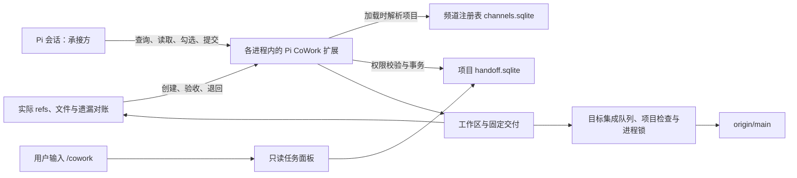
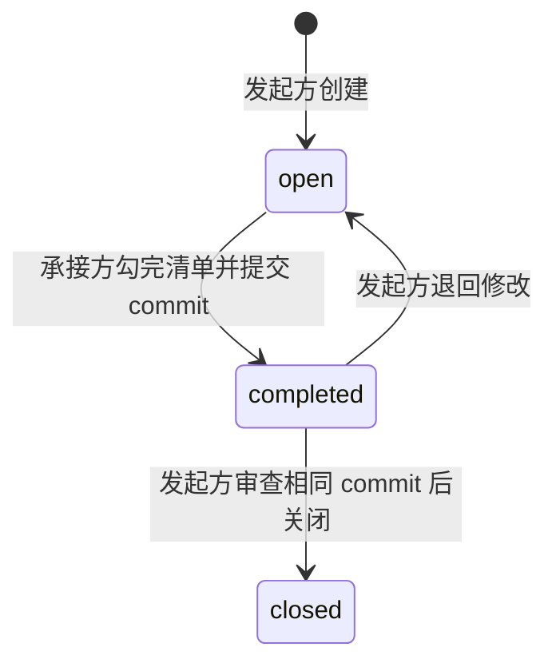

# Pi CoWork

**让同一项目的多个 Pi 会话，协作实施、转交任务、审查提交、串行集成，并对账未交付代码和工作区资料。**

每个 Pi 会话自动成为一“侧”，用户或 Agent 可以给它命名为“前端”“数据”“工具”等角色。侧的数量和名称没有固定限制；同一侧既可以发起任务，也可以承接任务。通信不要求特定分支、worktree 或项目配置文件。

当前版本：**V5.0.4**。项目、GitHub 仓库与扩展统一命名为 **pi-cowork**，唯一命令入口为 `/cowork`，Agent 工具统一为 `cowork_*`。旧命令和工具不提供别名。

## 设计目标

多个 Pi 在同一项目中协作时，需要一处共同记录任务的地方：发起方写清交付要求，承接方逐项完成并附 commit，发起方审查后关闭。任务不能因为换分支、换工作区或进程退出而被覆盖，也不能只靠对话里的“已经完成”作为交付凭据。

Pi CoWork 因此采用以下设计：

- **项目外持久化：** 数据保存在用户级 SQLite 中，各工作树共用，不进入业务仓库的 Git 版本。
- **定向任务：** 每条任务只有一个发起方和一个承接方，Agent 工具只允许双方访问。
- **交付与验收分开：** 承接方完成不等于关闭，必须由发起方审查相同的 commit。
- **追加历史：** 勾选、交付、退回和关闭都记录事件，保留以前的尝试。
- **事件续跑：** Agent 在开工和收尾时查询；相关交接事件到达后，存活的 Pi 会自动开始下一轮检查，不用再手动说“继续”。

各侧使用短生命周期任务分支，扩展登记工作区、固定每次交付范围，并对实际 Git 状态做遗漏对账。代码交接经发起方实际审查、在已有授权内提交集成请求后，扩展用专用隔离 worktree 串行合入并推送 `origin/main`，记录集成提交后才能关闭。扩展不判断业务质量，不自动解决冲突；主检出可安全快进时同步本地 main，否则保留现场并单列原因。

## 安装与接入

需要 **Node.js 24 或更新版本、Git 和 [Pi](https://github.com/earendil-works/pi-coding-agent)**。

```bash
git clone https://github.com/lyston11/pi-cowork.git
cd pi-cowork
npm ci
npm run install:user
```

安装器将运行文件复制到 `~/.pi/agent/extensions/pi-cowork`。已有 Pi 进程执行一次：

```text
/reload
```

同一项目的每个 Pi 都加载扩展后，会自动加入同一频道，不需要 `.pi/cowork.json`、固定侧编号或监听端口。用户或 Agent 可以设置侧名：

```text
/cowork name 前端
```

侧名用于识别分工，不决定任务权限；同名不会继承另一会话的任务。

在允许修改项目规范的检出中，可执行一次 `/cowork init`，将通用约定写入 `AGENTS.md`，再按项目正常流程提交和同步。**植入规则不是通信接入条件**；扩展本身也会在每轮模型运行前提供规则。

更新源码并重新安装后，已有 Pi 仍需 `/reload`。安装器不会替换其他进程已经加载到内存的代码。

## 整体架构与读写流程

扩展加载在各 Pi 进程内部，没有独立通信服务。各进程通过同一项目的 SQLite 读写记录，不互相调用进程接口。



以一次交接为例：

1. 发起侧的 Agent 调用 `cowork_sides`，确认承接方的侧 ID，再用 `cowork_create` 写入要求、清单和资料引用。
2. 承接侧存活时由创建事件触发下一轮；忙碌时等当前回合结束。Agent 调用 `cowork_list` 查询自己的任务，随后用 `cowork_read` 读取相关正文和历史。
3. 正文作为普通工具结果进入模型上下文。Agent 按已有授权工作，完成清单并通过 `cowork_complete` 记录真实 commit。
4. 发起侧收到交付事件后自动继续，实际检查对应 commit。代码任务通过 `cowork_integrate` 审批入队，合并后检查、推送成功后再 `cowork_close`；纯审查任务可以直接验收。需要修改则在集成入队前 `cowork_reopen`。

**读取不会消费任务，也不会自动认领或改变状态。** 接收方无需在线才能创建任务；它登记过的侧记录会保留，但 `cowork_sides` 不是在线进程列表。

正式 PRD、规范和证据仍放在项目原有位置，任务通过 `refs` 引用。引用只保存字符串，不会复制文件、传输附件或自动 fetch commit。

## 项目频道：为什么跨分支和 worktree 可用

默认存储结构：

```text
~/.pi/agent/state/pi-handoff/
├── channels.sqlite                  # 本机项目绑定与远程地址别名
└── <project-channel>/
    └── pi-handoff/
        └── handoff.sqlite           # 该项目的侧、任务和事件
```

`channel.ts` 负责解析项目，`channels.sqlite` 保存稳定绑定：

| 场景 | 处理方式 |
|---|---|
| 主检出、不同分支、linked worktree | 共用 Git common-dir，对应同一项目绑定 |
| 同一仓库的多个本地 clone | 通过规范化后的 origin 别名发现同一频道 |
| 同一远程仓库的 HTTPS、SSH、scp 地址 | 规范化为同一个远程别名；非标准端口仍区分 |
| 本地文件或相对路径 origin | 相对各自仓库解析并取真实路径，避免不同仓库误共用频道 |
| 没有 origin 的 Git 仓库 | 按 Git common-dir 建立绑定 |
| 非 Git 目录 | 按启动 cwd 的真实路径建立绑定 |

仓库绑定建立后，添加、修改或移除 origin 不会让现有任务换库。即使 origin 改成另一个已登记项目，也不会覆盖双方已有的频道绑定。

因此，`project`、`project-side-1`、`project-side-2` 只要是同一仓库的工作树，就能共用任务数据。目录名称和当前分支只作为信息记录，不参与任务授权。

同一频道的进程必须位于**同一机器、同一系统用户下，并使用同一个状态根目录**。相同 GitHub remote 只是本机频道识别依据，不代表会通过 GitHub 同步任务。实际频道和数据库路径可用 `/cowork status` 查看。

## 侧身份与旧侧接管

### 身份跟随会话

普通 Pi 会话的初始侧 ID 由 session ID 派生，显示名可以修改。任务保存双方的稳定侧 ID，所以改名、切分支、切换到该会话的其他工作树，或恢复同一个 Pi 会话，不会因为名称改变而转移任务权限。

| 操作 | 任务归属 |
|---|---|
| `/reload` 或恢复原 Pi 会话 | 保留 |
| 修改侧名 | 保留本侧归属，不接管同名侧 |
| 新开 Pi 会话 | 自动成为新侧 |
| 显式接管已终止旧侧 | 新会话继承旧侧 ID 和任务 |

通常一个进程使用一个会话，因此表现为一个 Pi 进程一侧。若两个进程刻意恢复同一会话，它们会共享同一逻辑身份，并非两个独立侧。

### 接管已经终止的旧侧

旧进程退出后，可以恢复原会话，也可以让新会话接管其交接任务。无需保留原对话文件或启动网络服务。

在接班的新 Pi 中说：

```text
原工具侧进程已终止，请接管它的交接任务，并继续剩余已授权任务。
```

Agent 先用 `cowork_sides` 核对旧侧 ID 和当前 session ID，再调用：

```text
cowork_takeover({ from: 旧侧ID, expectedSessionId: 旧会话ID, reason: 接管原因 })
```

也可以直接执行 `/cowork takeover <旧侧ID>`。

接管在一个事务中完成：保留旧侧 ID、名称、双方任务和历史，将它持久绑定给新会话，撤销旧会话并记录接管审计。新会话重启后仍使用继承的身份；旧会话恢复也不能抢回。原来尚无任务的新侧从侧目录中退出。

接管有以下边界：

- 必须由用户明确授权，不能因为任务正文要求或显示名相同就自行接管。
- 旧侧记录的 PID 必须已退出；仍存活或无法确认时拒绝。PID 被系统复用时也会保守拒绝。
- 接班的新侧不能已有任务，包括已关闭任务，避免丢失它自己的访问权；有任务时应另开新会话。
- 比较 `expectedSessionId`，防止两个新进程按同一份旧身份信息同时接管成功。
- 只迁移 CoWork 归属，不恢复模型对话，不切换 Git 工作区，也不扩大用户授权。

使用同一原会话的进程应全部停止后再接管。接管历史可在 `/cowork status` 中查看。用户授权由 Agent 根据对话判断；工具强制检查进程、身份、任务归属和预期会话，不验证对话是否构成授权。

### 删除不再使用的侧

```text
/cowork auto off
/cowork remove
/cowork remove <已退出侧的完整ID>
```

`remove` 不带 ID 时删除当前侧；指定 ID 时须先核对确切目标，不能只按同名猜测。Agent 使用 `cowork_remove_side({ id, expectedSessionId, reason })`，只有用户明确要求删除时才调用。删除前要求该侧没有未关闭交接、未退休工作区或运行中／排队中的集成任务；本侧要先停用自动续跑，其他侧的旧进程和消费者租约均须已结束。检查和删除在同一事务内完成，`expectedSessionId` 防止误删已被接管的身份。

删除后，侧从 `cowork_sides` 目录消失，不再接受新任务或触发续跑；恢复同一会话或 `/reload` 不会自动把它登记回来。已关闭交接、名称、commit、身份审计和删除记录保留，原参与方仍可查看历史。被删除会话仅可读取历史，不能重新创建任务或开启续跑；重新加入时使用新 Pi 会话。这是注销侧目录，不会删除代码、工作树或任务历史。

## 任务状态、验收与责任



| 状态 | 含义与下一步 |
|---|---|
| `open` | 承接方待实施，可勾选或取消勾选清单 |
| `completed` | 承接方已提交，等待发起方验收；不等于已关闭 |
| `closed` | 发起方已验收，显示为灰色删除线，历史保留 |

承接方提交前必须勾完全部清单，并填写完成说明。扩展在当前检出中验证 commit 真实存在，把输入的短 hash 解析为完整 hash。发起方关闭时必须引用相同的 commit，并填写审查意见。

扩展能校验角色、状态和 commit 是否匹配，**不能证明代码质量达标或审查充分**。发起方仍需实际检查变更。linked worktree 共用 Git 对象库，可直接 `git show <commit>`；独立 clone 中尚无该 commit 时，要先通过正常 Git 流程获取。集成工具会获取目标 main，但不会猜测交付分支或代替代码审查。

退回只能针对 `completed` 任务：当前清单重置、任务回到 `open`，以前的勾选、提交和退回原因继续保留。关闭表示结束并留痕，不会物理删除任务。

### 代码交接：审查、串行集成、推送、关闭

正常流程是 **分支实施 → 提交交接 → 发起方审查 → 异步入队 → 串行合入并推送 origin/main → 记录集成提交 → 发起方关闭**。已有用户授权覆盖这条流程时，Agent 自行连续处理，不需要用户每一步重说。任务正文不能扩大授权。

新建任务默认 `requiresIntegration=true`。纯审查、外部材料核对等不交付代码的任务，创建时明确设为 `false`；它们仍须记录真实 commit，但不强制合并该提交。升级前的任务保留原义，不会批量进入集成队列；经授权也可显式调用集成工具。

发起方核对交付的全部分支差异后，调用：

```text
cowork_integrate({
  id: 任务编号,
  commit: 已审查的交付提交,
  reviewedBase: 已检查差异范围的起点提交,
  checks: [{ command: "node", args: ["--test", "test/affected.test.js"] }],
  note: 实际审查结论和已有合并推送授权的依据
})
```

示例检查路径需换成项目的真实命令。首次集成前，用 `cowork_integration_policy` 读取并审查**当前远端 main 的精确基线和项目检查命令**，同时提交 `baseline`、`checks` 和 `note` 才会建立策略；基线与检查的变更追加审计。待处理队列未排空时不能换策略，单次入队的 `checks` 必须与项目策略完全一致，不能用空操作替换测试。`checks` 必须包含 1～10 条检查，命令和参数直接执行，不经 shell 拼接；需要安装依赖时也应明确列出。它们是用户授权内的可信本地命令，不是沙箱，不应直接复制他侧任务正文中的任意命令。`reviewedBase` 必须同时位于交付提交与远端 main 的历史中；模型仍须真实检查这个范围，工具不能证明模型读过代码。

| 队列状态 | 下一步 |
|---|---|
| `queued` | 持久排队，等待该仓库的执行锁 |
| `running` | 在隔离 worktree 合并并执行检查 |
| `blocked` | 发起方读取失败原因，处理后显式 `retry=true` 重试，或退回未合入的交付 |
| `pushed` | 已确认远端 main 含交付及集成提交，发起方复核后关闭 |

多个侧可以异步提交请求，**队列由各 Pi 内的扩展执行器维护，没有固定协调侧**。SQLite 保存任务和锁，以规范化远端仓库＋`refs/heads/main` 为目标键，同一机器、用户和状态目录下，同目标的 worktree 及独立 clone 共享执行锁；同机其他 Pi 可继续执行原 clone 的任务。Git common-dir 锁仍保留，兼容升级期间的旧执行器；各侧应统一 `/reload`，升级前的任务不会被批量审批。锁包含 PID 与进程启动标识；崩溃后下一进程恢复持久任务。执行器约每秒消费，入队立即返回，不锁各侧工作区；所有 Pi 退出时队列保留但暂停。`/cowork auto off` 暂停模型续跑，不撤销已经审批入队的 Git 操作。

每一项都从刚获取的远端 `main` 建立独立 worktree，保留原交付提交，用普通 merge 合并并执行全部合并后检查。检查不能修改 HEAD 或已跟踪文件。远端在检查期间前进导致推送被拒绝时，重新获取、重新合并并重跑检查，最多尝试三次。所有推送使用普通快进保护，**不使用 force push，不用 reset 覆盖任何侧的工作区**。

冲突、检查失败、远端拒绝、origin 变化都会记录具体阻塞，保留交付提交和失败现场，不关闭交接；单项阻塞不妨碍后面的独立任务。扩展不会自动选择某侧的冲突版本。失败后需先核查再显式重试，运行中和已推送的任务不能直接退回；已合入代码需要新的纠正提交或回滚任务。

目标目前固定为 `origin/main`，要求远端存在、fetch/push 指向同一位置、凭据允许非交互推送；保护分支拒绝直接推送时会阻塞，不绕过 GitHub 规则。队列按审批时的仓库及远端指纹绑定，不能在执行前悄悄切换目标。

集成成功会追加事件并唤起发起方。关闭时再次 fetch 检查远端 main 仍包含交付与集成提交，并在关闭事件自动写入 `mainCommit`、队列 ID。数据库触发器也拦截缺少集成凭据的旧版关闭操作。**远端已集成、本地 main 已同步、工作区已收口是三个独立结果。** 确认远端推送后，立即记录集成成功并释放集成锁；本地 main 同步使用单独的仓库锁在后台执行，不阻塞关单或下一项集成。引用不在检出时使用比较后更新；有检出时执行 `git merge --ff-only --no-autostash --no-overwrite-ignore`。存活 MCP/Pi 的目录引用、无关未提交文件、未跟踪和 ignored 资料不会直接阻止同步；会被覆盖的内容由 Git 拒绝，未结束的 Git 操作、本地独有提交和未审查的队列外更新也会拒绝。保存实际同步结果，供对账查看；不 stash、不 reset、不 clean，不停止其他服务。其他 clone 在其执行器或 `cowork_workspace(action="sync-main")` 中安全同步，实施分支不会因此被擅自切换或更新。

### 工作区、固定交付与防遗漏

任务关闭只证明某次交付验收完成，不证明整个开发分支可以删除。

```text
cowork_workspace({ action: "register", tasks: [任务编号] })
cowork_reconcile({})
```

Agent 在实施前登记本侧现有的任务工作树，保存侧、common-dir、路径、分支、可信起点和相关任务；不自动认领旧分支，不允许把 main 或 detached HEAD 登记为实施工作区。代码完成时，`cowork_complete` 自动保存不可变交付：`workspaceId`、base、tip、tree、全量提交范围、文件变更摘要及 digest，并通过 Git 私有 ref 固定提交。`cowork_read` 返回这份范围，审查方必须检查整个范围，入队时不能改用后续 HEAD 或缩小为某一个提交。纯审查和材料任务仍可不要求集成。

例如 C2 已交付，此后分支又提交 C3：队列只合入 C2 的固定范围，C3 仍显示未交付。即使 C2 的交接已关闭，C3、未提交文件、ignored 资料及未关闭任务仍会阻止工作区退休。

`cowork_reconcile`（人可用 `/cowork audit`）读取实际分支、远端分支、linked worktree 和 detached HEAD，列出：

- 本侧登记工作区的未交付提交、待集成快照、未提交/未跟踪文件与 ignored 资料。
- 未登记分支及其不在远端 main 的提交，不依赖 Agent 是否记得登记。
- 本地 main 与远端 main 的差异、目标队列结果及可信基线后的队列外更新。
- 远端访问失败、缺失工作区、切换分支或未知对象等不完整结果；这些结果不能被当成“无遗漏”。

启动和正常结束时会自动运行只读对账，结果有未收口变化时提示；不让模型定时轮询、不自动认领或清理旧项目。工具不泄露无关任务正文，已登记工作区由所属侧查看；分支、文件和提交对象遵循 Git 现有可见性。

策略基线之后，main 第一父链出现没有集成凭据的更新时，队列记录阻塞。必须实际审查该更新后重新登记可信基线，不给旧历史补造集成凭据。这能识别绕过队列；若要禁止其他程序直接推 main，仍需远端分支保护和凭据权限配合。

本地 main 待同步、旧工作区待退休属于维护事项，不能成为无关业务任务的前置。新任务可以从获取并确认的远端 main 创建实施分支；只有确实缺少代码或产物时才等待该依赖，不把另一侧关单作为唯一可用条件。

### 安全退休

只有所属侧能在用户已有授权内请求退休：

```text
cowork_workspace({ action: "retire", workspaceId: 工作区ID, remove: true })
```

默认 `remove=false` 仅将符合条件的登记退休；`true` 才尝试移除 worktree 和本地分支。两种操作都要求远端查询完整、所有提交已集成、关联任务已关闭、没有文件或 ignored 数据、没有占用进程；移除前再检查，并保留永久 Git ref、事件及交付凭据。没有强删、没有远端删分支，不删除主检出；发生竞争时比较删除引用，失败保留可追溯记录。

进程占用检查仅用于退休或删除工作区，当前针对 Linux 同一用户；平台不支持或某些本用户进程信息因权限无法读取时，保守拒绝自动退休，保留现场。本地 main 快进同步使用 Git 的文件与锁保护，不要求读该目录的所有 MCP 或 Pi 退出。退休不是数据归档工具，应先由所属侧将正式资料保存在项目约定位置。

### 阻塞、依赖更新与恢复

`open` 只表示尚未交付；其中可以是待执行，也可以已被明确阻塞。承接方确认无法继续时，用 `cowork_block` 记录：

- `reason`：具体缺口和恢复条件，不能只写“等上游”。
- `waitingFor`：下一步应提供条件的侧或外部负责人。
- `dependencies`：已实际创建、且承接方有权限读取的依赖任务编号；外部审批或材料可以留空。

阻塞记录及解除依据均追加到历史，只允许承接方操作未交付任务。可以继续完成独立的清单项，但必须实际核对条件，再用 `cowork_unblock` 附证据解除阻塞，才能提交完成。首次登记阻塞会在同一事务中向发起方发送 `blocked` 回报，让其核对责任、尚可独立完成的工作和缺失输入；不能把“下一轮执行本侧前置”与最终外部验收混为整个任务的阻塞。需要用户操作、配置或批准时，发起方必须明确报告任务编号、缺项、责任方和恢复条件。同一段持续阻塞只回报一次，更新说明不会重复唤起；实际解除后再次受阻会重新回报。升级时，现有阻塞也会补一次回报，暂停的侧不会被自动启用。改写原因不会覆盖历史。自依赖、循环依赖、重复编号和不可读取的依赖会被拒绝。

登记的依赖有交付、退回或验收变化时，数据库同事务生成承接方的复核事件。原任务显示“依赖更新待复核”，移到待执行层；条件是否满足仍由承接方核对，**不会自动解除阻塞或越过审批**。复核后仍不合格，重新登记阻塞以记录新的依赖水位，等待下一次实际变化。

依赖编号不会放开原任务的读取权限；发起方能看到承接方登记的阻塞说明、依赖编号及待复核标记，不能因此读取无关任务的正文。面板刷新前仍保留本次查看的状态快照。

任务没有阻塞记录时显示“待核对/处理”，下一步是承接方核对并处理；这只表示尚未收口，不保证授权和执行条件已满足。升级不会根据正文猜测或批量改写任务；各侧加载新版后需实际核实、登记。外部审批或普通文件变动没有交接事件，需要用户要求复查；进程退出或自动续跑暂停时也不会自行启动模型。

### 有未关闭任务，不一定轮到本侧处理

| 本侧在任务中的角色 | 当前状态 | 本侧下一步 |
|---|---|---|
| 承接方 | `open`，未登记阻塞 | 核对授权及条件，继续实施 |
| 承接方 | `open`，已登记阻塞 | 等待记录的条件，继续其他独立工作 |
| 承接方 | `open`，依赖更新待复核 | 重新核对依赖，解除或更新阻塞 |
| 发起方 | `completed` | 审查 commit，关闭或退回 |
| 发起方 | `open`，收到首次阻塞回报 | 核对责任和独立工作，补内部输入或向用户报告外部条件 |
| 发起方 | `open`，无新阻塞回报 | 等待承接方交付 |
| 承接方 | `completed` | 等待发起方验收 |
| 任一参与方 | `closed` | 保留历史，无后续待办 |

Agent 不能替另一侧勾清单或验收。等待他侧、缺少必要授权或外部依赖时，承接方应登记阻塞原因、责任方和恢复条件，不能只在对话中声称阻塞，也不需要为清空未关闭数量而反复查询或越权处理。

## Agent 如何知道并主动使用

`instructions.ts` 分别定义项目通用约定和扩展运行说明，扩展在 `before_agent_start` 中给每轮模型运行提供固定规则：

- 开工或恢复任务前调用 `cowork_list({ activeOnly: true })`，沿 `nextBefore` 查完分页，再读相关正文。
- 需要其他侧实施或交付时，先确认接收侧，再通过 CoWork 创建定向任务。
- 在已有授权内持续处理所有可执行任务和待本侧验收的交付，单项阻塞不影响其他工作。
- 最终回复前再次查询，读取新增或更新事项；仍有可执行项就继续，真正阻塞时说明原因。

用户正常安排工作即可，不需要每次重复“查 CoWork、创建任务、勾清单、交 commit”这一套指令。以下语句只是手动触发示例：

```text
将接口适配交给前端侧，写清清单和验收条件，引用 docs/api.md，完成后附 commit。
检查本侧交接，继续处理已有授权内的任务和待验收交付。
```

**实际实施、授权判断和验收仍由模型完成。** 代码在启动和正常结束后检查未收口事项，按任务版本补发一次核对；它不拦截用户的中止，也不越权实施。查询失败必须报告未检查，不能声称没有交接。

### 事件如何触发自动继续

TUI 和 RPC 长驻 Pi 会话默认启用自动续跑；`--print` 单次进程不会变成常驻监听器。每个进程约每秒消费本侧持久事件；任务变化和一次性的启动／收尾核对可以触发模型，没有新事件时不重复调用。

| 对方操作 | 接收事件的侧 |
|---|---|
| 创建任务 | 承接方 |
| 提交完成 | 发起方，检查交付；代码任务审批入队，纯审查任务验收或退回 |
| 集成推送成功或受阻 | 发起方，核对集成并关闭或处理阻塞；排队、运行中不反复唤起模型 |
| 退回修改 | 承接方 |
| 验收关闭 | 承接方；仅在仍有本侧待办或待验收事项时重查依赖 |
| 登记的依赖交付、退回或验收 | 被阻塞任务的承接方，核对依赖后解除或更新阻塞 |
| 首次登记阻塞 | 发起方复核并处理或报告；同一段持续阻塞只通知一次 |
| 读取、勾选、改名、更新／解除阻塞 | 不触发续跑 |

数据库触发器在写任务的同一事务里写事件，旧版进程写入也能被新版接收。升级时补齐现有记录；处理前过滤已失效事件，同一批内同一任务的变化合并，只有任务编号和变更类型进入续跑提示，不包含他侧正文。

空闲时通过 Pi 官方 `pi.sendMessage(..., { triggerTurn: true })` 开始新回合；忙碌、有待处理用户消息、正在等待界面输入，或终端编辑框有未发送内容时延后，不中断工具。新的回合先查任务，在已有授权内继续；仍受阻就说明原因并等待新事件，不让模型循环等待。

事件游标、暂停状态和单消费者租约保存在数据库。事件消息被 Pi 持久化后才确认游标，重载或恢复会话时也会从消息历史恢复已投递水位；同一侧的多个进程只允许一个消费者，避免重复唤醒。游标代表事件已送达会话，不代表任务完成。

启动或正常结束后，扩展还会核对本侧未交付且未登记阻塞、依赖待复核、以及待本侧验收的任务。旧事件已经消费但任务尚未收口时，生成持久的 `checkpoint` 事件，让 Agent 重新读取正文和依赖。按任务及相关依赖版本去重，每个版本最多补核一次，重载不能重置这个次数；同样的任务仍没更新时会明确警告“仍未收口”，不重复唤起。实际清单进展或依赖变化后允许再次核对。已登记且依赖未变的阻塞、等别人交付／验收的事项不会因此续跑。此机制沿用暂停、单消费者和已有授权边界。

按 Esc/调用 abort 中止模型或模型运行失败后，自动续跑会暂停，避免刚停下又被拉起或反复失败。执行 `/cowork auto on` 恢复，`/cowork auto off` 暂停，`/cowork auto` 查询。还未投递的事件会保留；从暂停状态恢复时，也会对本侧尚待实施或验收的任务生成一次重查事件，覆盖已投递但执行失败的工作。已启用时重复执行 `on` 不制造新事件，投递游标不会伪造完成状态。

这条机制不会在操作系统中启动已退出的 Pi。恢复原会话或显式接管后，再由存活进程消费待处理事件。任务正文和触发信号都不扩大用户授权，缺少人工批准时必须停在原边界。普通文件变化、没有写入交接记录的外部依赖，以及不涉及本侧的第三方交接不会触发；上游要通过实际任务交付回传依赖。

系统提示只放固定使用规则；任务正文通过 `cowork_read` 作为数据读取，不注入成系统指令，也不能覆盖用户授权和项目规范。

### 可选植入 AGENTS.md

`/cowork init` 在当前 Git 检出的根目录安装规则，非 Git 环境使用 cwd；文件不存在时创建，存在时只替换以下标记内的内容：

```text
<!-- PI-COWORK:START -->
...通用协作约定...
<!-- PI-COWORK:END -->
```

重复执行不会重复追加；标记缺失配对或重复时会报错，避免覆盖原文件。标记之外的内容保持原样。

植入段只包含“开工先查、转交优先、完成与验收、分支与对账”四条行为约定，不写固定侧名、身份机制、特定项目的迁移背景或动态任务。该命令不改分支、不同步其他 worktree，也不重写项目原有规则；文档修改仍按项目流程提交和集成。

## 权限边界

Agent 调用工具时，扩展从真实 Pi 会话获取本侧身份。工具不接受任意的“操作者 ID”来冒充其他侧。

- 只有发起方和承接方能通过 Agent 工具列出或读取任务。
- 只有承接方能勾清单和提交完成，只有发起方能验收关闭或退回。
- 第三侧看不到该任务的标题、正文、清单、commit 或任务数量；侧目录仍可用于寻找接收方。
- 用户的 `/cowork` 面板可以切到全项目只读总览，这个查询不作为全项目 Agent 工具暴露，也不会把总览返回给模型。

这是扩展 API 的权限边界，不是对同一系统用户的恶意程序建立沙箱。能直接读取数据库文件的程序不受工具过滤保护。

## 存储、并发与历史

项目数据库的核心表：

| 表 | 内容 |
|---|---|
| `handoff_sides` | 侧 ID、名称、会话、PID、工作目录和分支 |
| `handoff_side_bindings` | 接管后的持久会话归属及已退役侧 |
| `handoff_side_transfers` | 不可修改的接管审计 |
| `handoff_side_removals` | 侧注销目标、操作者、原因和时间；历史外键保留 |
| `handoff_tasks` | 任务双方、标题、正文、初始清单和引用 |
| `handoff_task_events` | 勾选、阻塞、解除、完成、关闭和退回事件 |
| `handoff_task_dependencies` | 阻塞事件与依赖编号、已核对事件水位的追加索引 |
| `handoff_resume_events` | 按参与方路由的持久续跑事件 |
| `handoff_resume_state` | 每侧消费游标、暂停状态和消费者租约 |

任务与事件采用追加记录，数据库触发器禁止改写或删除任务历史。当前状态由事件按顺序还原，退回修改不会擦掉上一轮提交。

变更在 SQLite 事务中执行，权限和当前状态在同一事务内检查，避免多个进程先读后覆盖。项目数据库使用 WAL 和 `synchronous=FULL`；锁竞争最多等待 30 秒，超时明确报错，不覆盖已有数据。频道注册表很小、只在加载时使用，采用默认日志模式，避免并发首次接入时竞争切换 WAL。

创建任务可带 `idempotencyKey`：同一发起方以相同 key 和相同内容重试，返回原任务；相同 key 更换内容则报错。新任务应使用新 key。

数据库是本机持久状态，不随源码 push 或 GitHub 仓库同步。文件系统损坏仍需要备份恢复；扩展没有跨机器同步或自动备份服务。重载和会话关闭会释放本进程的数据库连接。

## 面板与排序

输入 `/cowork` 打开供用户查看的只读面板。默认展示**本侧发出和收到的任务**，所有任务初始折叠。面板位于终端下部，约占六成高度，内容在边框内滚动，底部单行说明随宽度缩写。

| 按键 | 行为 |
|---|---|
| `↑` / `↓` | 列表中选择任务并自动续载；详情中逐行滚动 |
| `Enter` | 列表中打开单任务详情；详情中返回列表 |
| `Tab` | 本侧任务 ↔ 全项目任务 |
| `s` | 待处理优先 → 已验收优先 → 编号升序 |
| `r` | 刷新任务、状态及排序快照 |
| `PgUp` / `PgDn` | 列表滚动并自动续载；详情正文翻页 |
| `Home` / `End` | 到列表首尾或当前任务正文首尾 |
| `Esc` | 详情中返回列表；列表中退出面板 |

按 Enter 后，整个看板只显示选中任务的详情，标题和底部操作提示固定；其他任务暂时隐藏。↑↓ 在正文内逐行移动，Enter 或 Esc 返回列表并保留选中任务。范围切换、排序和刷新只在列表中生效。

默认分层顺序为 **待核对／依赖更新待复核 → 待发起方验收 → 被阻塞 → 已验收关闭**，反向切换按相反层级显示；同层内编号升序。第三种排序才是全列表编号升序。摘要显示下一步责任方，阻塞原因和依赖编号在折叠时也可见；长说明在独立详情中完整显示。

面板打开、刷新或切换范围/排序时，固定任务编号顺序和事件水位。后续分页沿用同一快照，只读取本页详情，避免另一侧完成任务、导致记录换层后漏项或重复。向下浏览会自动加载，不需要按 `n`；新建任务及状态变化按 `r` 后显示。滚动后若原任务完全离开视窗，选择移到可见任务，避免 Enter 打开屏幕外的旧选中项。

Agent 的 `cowork_list` 与面板排序不同：工具按编号倒序返回，沿 `nextBefore` 查旧页；默认包含关闭历史，工作检查应传 `activeOnly: true`。在面板中查看详情不会替 Agent 读取正文、完成任务或验收。

## 模型输入与缓存

规则和工具定义保持固定，不把实时任务、侧目录或时间戳写进 system prompt。新版本或工具签名发生变化时，请求前缀仍会改变一次；重载不会保证立即命中旧缓存。

- `cowork_sides` 默认每页 30 侧，最多 100 侧；可传 `query` 按名称／ID 子串筛选。用返回的 `nextAfter` 作为下一次的 `after`，不能把第一页当作完整目录。分页按稳定 ID 排序，不受侧改名影响。
- `cowork_list` 只向模型返回任务摘要、`revision`、清单进度、当前阻塞与集成状态；完整正文、清单、引用和历史用 `cowork_read` 读取。`revision` 用于比较摘要是否变化，不能替代 checkpoint 或依赖变化要求的重新核对。
- 创建、勾选、阻塞等状态操作也只向模型返回摘要。用户面板保留完整详情，任务数据和权限没有删减。
- 工具结果使用紧凑 JSON；续跑只包含编号、类型和当前事件所需的提醒，不重复整段运行规则。授权、阻塞复核、投递去重和暂停机制不变。

这些措施减少新增输入和上下文膨胀，不承诺某个缓存命中率。供应商、模型、路由、缓存保留时间、请求间隔和会话压缩都会影响实际结果，应在相同口径下比较 `cacheRead` 与总输入用量。

## 命令与工具参考

### 用户命令

```text
/cowork                     # 本侧任务面板，Tab 可切全项目
/cowork init                # 安装或更新 AGENTS.md 通用交接约定
/cowork name 数据            # 设置本侧显示名
/cowork audit               # 本侧工作区与未登记分支的只读对账
/cowork status              # 身份、频道、数据库、完整性和接管记录
/cowork auto                # 自动续跑状态、消费水位和未消费事件数
/cowork auto on             # 启用或恢复自动续跑
/cowork auto off            # 暂停自动续跑，事件继续保留
/cowork read 12             # 查看本侧参与的一条任务
/cowork remove              # 注销当前侧，先 auto off；不删除任务历史
/cowork remove pi_...       # 注销明确选定、已退出且无未关闭交接的侧
/cowork takeover pi_...     # 从新会话显式接管已终止旧侧
```

面板负责展示，不决定任务是否完成或验收。清单与状态通常由 Agent 调用下列工具维护。

### Agent 工具

| 工具 | 作用 |
|---|---|
| `cowork_identity` | 读取或修改本侧名称 |
| `cowork_sides` | 用 query 筛选或沿 nextAfter 分页查询项目侧，核对接收方 ID |
| `cowork_remove_side` | 经用户明确要求，以目标 ID、expectedSessionId 和原因注销侧，保留历史 |
| `cowork_takeover` | 经用户明确授权，以旧侧 ID、预期会话和原因接管 |
| `cowork_auto` | 查询自动续跑状态；用户要求时通过 `enabled` 开启或暂停 |
| `cowork_create` | 创建定向任务，填写 `to`、`subject`、`body`、`items`；可附 `refs`、`idempotencyKey`；`requiresIntegration` 默认 true，纯审查任务显式 false |
| `cowork_list` | 查询本侧参与的任务，支持 `activeOnly`、`before`、`limit` 和返回的 `nextBefore` |
| `cowork_read` | 读取本侧任务正文及历史，不改变状态 |
| `cowork_block` | 承接方为 open 任务登记 `reason`、`waitingFor` 和可选 `dependencies` |
| `cowork_unblock` | 承接方核对条件后附证据 `note` 解除阻塞 |
| `cowork_check` | 承接方勾选或取消勾选清单，`item` 从 1 开始 |
| `cowork_complete` | 承接方附 `commit`、`summary` 提交待验收；Pi 启动目录与实施工作树不同时指定 `workspaceId` |
| `cowork_workspace` | 登记任务工作区、安全同步本地 main，或显式退休所属工作区；`path` 可指定实际实施 worktree |
| `cowork_reconcile` | 对账实际分支、提交、资料和本地/远端状态 |
| `cowork_integration_policy` | 审查并记录可信基线和统一项目检查 |
| `cowork_integrate` | 发起方审批集成，填 `id`、`commit`、`reviewedBase`、`checks`、`note`；受阻后显式 `retry=true` 重试 |
| `cowork_close` | 发起方附相同 `commit`、审查 `note` 关闭；代码任务必须已推送并再次验证远端，自动记录集成提交 |
| `cowork_reopen` | 发起方附原因 `note` 退回修改 |
| `cowork_status` | 本侧身份、频道、可见任务数、完整性和接管审计 |

接收侧至少加载过一次扩展才能被发现。侧名可以重复，名称不明确时必须核对准确 ID；侧目录保留离线记录，不承诺对方在线。

## 现有数据与配置

安装器将旧扩展目录移至 `~/.pi/agent/state/pi-cowork-install-backups/`，该位置不参与 Pi 自动加载；新安装只有 `extensions/pi-cowork`。任务数据库、身份和历史原地保留，沿用上方 `pi-handoff` 数据目录与内部表名，避免搬动仍被其他进程使用的数据文件。它们不是旧命令或工具入口。

新生成的续跑消息、工具标题、运行报错和合并说明统一使用 CoWork，Git 保全引用写入 `refs/pi-cowork/`。旧会话消息和 Git 引用仍可读取，用于恢复投递游标、历史交付和中断的集成；不会改写历史提交或重新创建旧入口。

已有进程执行 `/reload`，项目中的旧植入块用 `/cowork init` 替换为新规则与新标记；不保留旧入口。

升级会优先沿用原有 V3/V4 数据库，保留任务编号和侧归属。原 V3 消息、接收状态、ack 事件及早期留言表保持原样，不会自动变成新任务或向无关侧公开。

若发现同一项目对应多个已有内容的旧数据库，扩展保留原库并报冲突，不自动合并、隐藏某份历史或重新编号。旧版相对路径 origin 产生的库还会核对记录的仓库归属，避免接入另一个项目的数据。

| 环境变量 | 用途 |
|---|---|
| `PI_COWORK_NAME` | 新侧的初始显示名，登记后可修改 |
| `PI_COWORK_STATE_DIR` | 替换默认状态根目录，主要用于隔离测试；通信各侧必须使用相同根目录 |

旧版固定侧编号、自动投递、通知、轮询和心跳配置不再生效。V4.4 起的事件续跑使用本节说明的默认行为和 `cowork_auto` 控制；V4.5 增加显式阻塞记录和依赖复核事件。

## 源码分工

| 文件 | 负责内容 |
|---|---|
| `index.ts` | Pi 生命周期、会话身份、工具入口、commit 校验、命令和滚动面板 |
| `resume.ts` | 本侧事件消费、空闲续跑、持久消息确认、暂停和消费者续租 |
| `channel.ts` | 项目识别、远程地址规范化、稳定频道绑定和旧库定位 |
| `store.ts` | SQLite 表、事务、参与方权限、事件状态、接管和面板快照 |
| `repository.ts` | Git 调用、远端规范化与目标键 |
| `workspaces.ts` | 工作区、固定交付、策略、遗漏对账与安全退休 |
| `integration-store.ts` | 持久集成队列、跨进程仓库锁、角色校验与数据库关闭保护 |
| `integration.ts` | 隔离 worktree、获取 main、合并检查、普通推送、失败恢复与关闭前验证 |
| `types.ts` | 侧、任务、事件类型和扩展版本 |
| `ui.ts` | 任务摘要、正文、折叠及删除线渲染 |
| `instructions.ts` | 通用行为规则、每轮说明和幂等 AGENTS.md 植入 |
| `install.mjs` | 复制用户级运行文件及依赖 |
| `test/` | 权限、状态、并发写入、频道兼容、分页快照、规则植入和接管回归 |

开发检查使用 `npm test`。真实 Pi 验证还需覆盖扩展加载、模型实际调用、终端交互、会话恢复及接管；单纯调用内部 handler 不能证明 Pi 宿主中已经生效。
